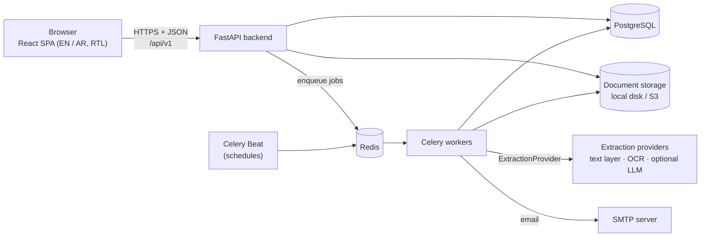
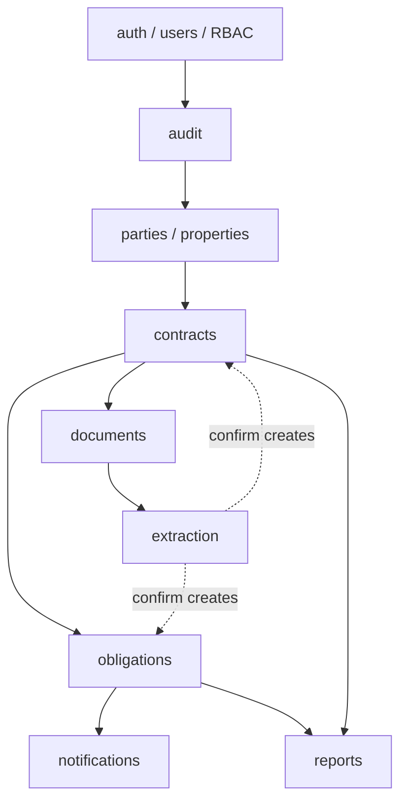
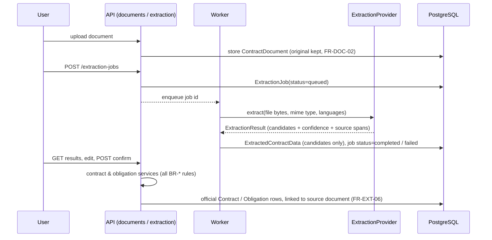

# Architecture

This document describes how the Contract & Obligation Management System (COMS) is structured and why.
Requirements are referenced by their SRS IDs (see [SRS.md](./SRS.md)).

## 1. Overview

**ConTrack** (repository: COMS) is a web application made of a React single-page frontend and a Python REST API, backed by
PostgreSQL, document storage, and background workers.



| Concern | Choice | SRS link |
|---|---|---|
| API | FastAPI (Python 3.12), Pydantic v2, OpenAPI generated from code | 10.2, NFR-MAIN-01 |
| Database | PostgreSQL 16, SQLAlchemy 2, Alembic migrations | 7.1, NFR-SCALE-01 |
| Background jobs | Celery + Redis, Celery Beat for schedules | NFR-PERF-03, FR-OBL-05, FR-NOTIF-01/02 |
| Document storage | `StorageBackend` interface (`app/core/storage.py`): local disk now (`STORAGE_DIR`); an S3-compatible backend can implement the same interface for production | FR-DOC-02, NFR-SEC-05, NFR-BACK-02 |
| Extraction | `ExtractionProvider` interface in an isolated module | 2.5, NFR-SCALE-02, Appendix B |
| Frontend | React + TypeScript + Vite, Ant Design, TanStack Query, react-i18next | NFR-UX-01..03, NFR-MAIN-02 |
| Auth | Short-lived JWT access token + rotating refresh token (httpOnly cookie), Argon2 password hashing | FR-AUTH-*, NFR-SEC-01..04 |

## 2. Modules

Each product function in SRS 2.2 maps to one backend module and one frontend feature folder.
Modules are delivered in this order (one branch and one PR each):

| # | Module | SRS 2.2 functions | Requirements | Backend package | Frontend feature |
|---|---|---|---|---|---|
| 1 | Auth, users & RBAC | Authentication and authorization; User and role management | FR-AUTH-*, FR-USER-*, 3.2, NFR-SEC-01..04 | `app/modules/auth`, `app/modules/users` | `features/auth`, `features/users` |
| 2 | Audit trail | Audit logging | FR-AUD-* | `app/modules/audit` | `features/audit` |
| 3 | Parties & properties | Party management; Property association | FR-PARTY-*, FR-PROP-* | `app/modules/parties`, `app/modules/properties` | `features/parties`, `features/properties` |
| 4 | Contracts | Contract management | FR-CON-*, 4.4, BR-02, BR-03, BR-06, BR-07 | `app/modules/contracts` | `features/contracts` |
| 5 | Documents | Document upload and management | FR-DOC-*, BR-09, NFR-SEC-05/06 | `app/modules/documents` | `features/documents` |
| 6 | Obligations | Obligation management; Deadline and renewal tracking | FR-OBL-*, 4.10, BR-01, BR-04, BR-08 | `app/modules/obligations` | `features/obligations` |
| 7 | Search & filtering | Search, filtering, sorting, and pagination | FR-SEARCH-*, NFR-PERF-02 | `app/core/listing.py` + per-module queries | `components/data-table` |
| 8 | Notifications | Notifications and reminders | FR-NOTIF-* | `app/modules/notifications` | `features/notifications` |
| 9 | Extraction | Contract information extraction | FR-EXT-*, §8, BR-05, NFR-PERF-03, NFR-REL-03 | `app/modules/extraction` | `features/extraction` |
| 10 | Dashboard & reports | Dashboard and reporting | FR-REP-* | `app/modules/reports` | `features/dashboard`, `features/reports` |

### Module dependency direction



A module may call the **service layer** of modules above it, never their routers or tables directly.
`extraction` never writes to `contracts` or `obligations` tables itself: on confirmation it calls the
contract and obligation services, so every business rule (BR-01..BR-09) is applied exactly once (BR-05).

## 3. Backend structure

```
backend/
  app/
    main.py                 # create_app(): middleware, error handlers, routers
    api/router.py           # mounts every module router under /api/v1
    core/                   # cross-cutting: config, db, errors, logging, security, permissions, listing
    models.py               # imports every module's models (for Alembic)
    modules/<module>/
      models.py             # SQLAlchemy ORM models
      schemas.py            # Pydantic request/response models (the API contract)
      service.py            # business logic and rules (BR-*), permission scope, audit calls
      router.py             # HTTP layer only: parse, authorize, call service, serialize
    workers/                # Celery app and task entry points (thin; call services)
  alembic/                  # migrations
  tests/                    # pytest; tests named by TC ID and tagged @pytest.mark.req("FR-...")
```

Layering rules:

- **Routers are thin.** They declare the permission they require (`require_permission(...)`) and delegate to a service.
- **Services own the rules.** Business rules and data-scope filtering live in services so they apply equally to
  HTTP requests, background jobs and the extraction confirmation flow (Appendix B: the backend enforces rules,
  the frontend only mirrors them for usability).
- **Errors are typed.** Services raise `AppError` subclasses (`NotFoundError`, `BusinessRuleError`, …); the API turns
  them into the standard envelope (see [api-standards.md](./api-standards.md)). Unexpected errors are logged and
  returned as a generic 500 (NFR-REL-02).

## 4. Extraction: isolated and replaceable

SRS 2.5, NFR-SCALE-02 and Appendix B require that the OCR/AI technology can change without redesigning the core.



Design points:

- **One interface.** `ExtractionProvider.extract(document) -> ExtractionResult`. The result schema is ours, not the
  vendor's, so swapping providers never touches the review UI or the confirmation logic.
- **Providers are chosen by configuration** (`EXTRACTION_PROVIDER=…`), not by code changes. Planned providers:
  `text` (pdfplumber / python-docx for digital files), `ocr` (Tesseract, Arabic + English) and an optional `llm`
  adapter that is **disabled by default** because sending contract text to an external service is a
  data-protection decision for the business.
- **Candidates are never official data** (BR-05, FR-EXT-05). They live in `extracted_contract_data` until an
  authorized user confirms them.
- **Asynchronous and observable.** Extraction runs in a worker (NFR-PERF-03); every job has a visible status
  (`queued`, `processing`, `completed`, `failed`) and a stored failure reason (NFR-REL-03, FR-EXT-01).
- **Independently scalable.** Extraction tasks run on their own Celery queue so extraction workers can be scaled or
  moved to other hosts without affecting reminders or the API.

## 5. Background jobs

| Job | Trigger | Requirement |
|---|---|---|
| Mark overdue obligations | Celery Beat, hourly (and evaluated on read) | FR-OBL-05, BR-04 |
| Generate next occurrence of recurring obligations | Celery Beat, daily | FR-OBL-06, BR-08 |
| Upcoming-deadline reminders | Celery Beat, daily | FR-NOTIF-01 |
| Overdue notifications | When an obligation becomes Overdue | FR-NOTIF-02 |
| Document extraction | On request, `extraction` queue | FR-EXT-01, NFR-PERF-03 |

Jobs are idempotent: running one twice must not duplicate notifications or occurrences.

## 6. Security

- **Authentication on every protected endpoint** through a FastAPI dependency (NFR-SEC-01, FR-AUTH-02).
- **RBAC in the backend**: permission codes are seeded from the 3.2 matrix and checked per endpoint; data scope
  (e.g. a Property Manager sees only assigned properties) is applied in services (FR-AUTH-03, NFR-SEC-02).
  See [roles-and-permissions.md](./roles-and-permissions.md).
- **Passwords** are hashed with Argon2 (NFR-SEC-03). **HTTPS** is required in production (NFR-SEC-04).
- **Documents** are never served from a public path; downloads stream through an endpoint that checks permissions
  (NFR-SEC-05). Uploads are validated by size and by detected content type, not only by extension (NFR-SEC-06).
- **Audit log** is append-only at the database level (FR-AUD-03).

## 7. Frontend structure

```
frontend/src/
  app/            # router, providers (query client, auth, theme / direction)
  api/            # generated OpenAPI types + typed fetch client
  components/     # shared UI (data table with server-side paging, forms, layout)
  features/<m>/   # one folder per module: pages, hooks, components, tests
  i18n/           # i18next setup and locales (en, ar)
```

- **API types are generated from the backend's OpenAPI document**, so the frontend consumes the documented API and
  does not re-implement business logic (Appendix B, NFR-MAIN-02).
- **English and Arabic** are supported from the start; switching to Arabic flips the whole layout to right-to-left
  through Ant Design's `ConfigProvider direction` and `<html dir>`.
- **UI permissions mirror the backend** (hide actions the user cannot perform), but the backend remains the
  authority.

## 8. Environments

| Environment | How it runs |
|---|---|
| Local | `docker compose up` for infrastructure; API (`uvicorn`) and frontend (`vite`) on the host. |
| CI | GitHub Actions: lint + type-check + tests for backend (with a Postgres service) and frontend on every PR. |
| Production | To be decided (SRS 2.5 "final technology stack is to be confirmed"). Requirements: HTTPS, managed Postgres with backups (NFR-BACK-01), S3-compatible storage included in backups (NFR-BACK-02). |
