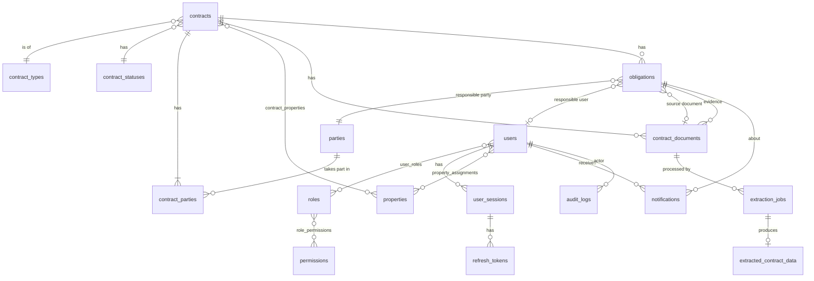

# Database Schema

PostgreSQL schema for the entities in SRS 7.1, with the fields from 7.2 (contracts) and 7.3 (obligations).
This document is the design target; each table is created by the module that owns it (see the **Module** column),
and this file is updated in that module's PR if the design changes.

## Conventions

- **Primary keys:** `id UUID` (generated by the application). UUIDs avoid exposing record counts in URLs.
- **Timestamps:** `TIMESTAMPTZ`, stored in UTC. Business dates (start/end/due dates) are `DATE`.
- **Created/updated metadata** (7.2): every business table has `created_at`, `updated_at`, `created_by_id`, `updated_by_id`.
- **Money:** `NUMERIC(18,2)` plus `currency CHAR(3)` (ISO 4217).
- **Controlled lists** (FR-CON-06, 4.4): lookup tables with a stable `code`, so the business can add or rename values
  without a code change.
- **Soft archive** instead of delete for contracts (`archived_at`), so history and audit stay intact (BR-07).
- **Constraint names** follow the naming convention in `app/core/db.py`, for stable migrations.

## Entity relationship diagram

## Tables

### Identity and access — module 1 (`auth-users-rbac`)

**`users`** (7.1 User)

| Column | Type | Notes |
|---|---|---|
| id | UUID PK | |
| email | VARCHAR(320) UNIQUE NOT NULL | Login identifier. Stored lower-cased (`CHECK email = lower(email)`), so uniqueness is case-insensitive. |
| full_name | VARCHAR(200) NOT NULL | |
| password_hash | VARCHAR(255) NOT NULL | Argon2 hash; never plain text (NFR-SEC-03). |
| preferred_language | VARCHAR(5) NOT NULL DEFAULT 'en' | `en` or `ar` (CHECK). |
| is_active | BOOLEAN NOT NULL DEFAULT true | Deactivated users cannot log in (FR-USER-03). |
| last_login_at | TIMESTAMPTZ | |
| created/updated metadata | | |

**`roles`** (7.1 Role): `id`, `code UNIQUE` (`admin`, `contract_manager`, `legal`, `property_manager`, `employee`, `management`), `name`, `description`, `data_scope` (`all`, `assigned_properties`, `assigned_obligations`).

**`permissions`**: `id`, `code UNIQUE` (e.g. `contract:create`), `description`.

**`role_permissions`**: `role_id FK`, `permission_id FK`, PK (`role_id`, `permission_id`). Seeded from the 3.2 matrix.

**`user_roles`**: `user_id FK`, `role_id FK`, PK (`user_id`, `role_id`). A user's permissions are the union of their roles.

**`user_sessions`**: `id`, `user_id FK`, `created_at`, `expires_at`, `revoked_at`, `remember` ("Keep me signed in"), `user_agent`, `ip_address`. One row per login.
Access tokens carry the session id and every request checks `revoked_at`, so logout, deactivation and password reset
take effect immediately (FR-AUTH-04, FR-USER-03).

**`refresh_tokens`**: `id`, `session_id FK`, `token_hash` (SHA-256, UNIQUE), `created_at`, `expires_at`, `used_at`.
Single-use: refreshing marks the token used and issues a new one. Presenting a used token more than 10 seconds later
revokes the whole session (token theft); within 10 seconds it is just rejected (two tabs refreshing together).

### Audit — module 2 (`audit-trail`)

**`audit_logs`** (7.1 AuditLog, FR-AUD-01..03)

| Column | Type | Notes |
|---|---|---|
| id | UUID PK | |
| occurred_at | TIMESTAMPTZ NOT NULL DEFAULT clock_timestamp() | Timestamp. `clock_timestamp()`, not `now()`, so records written in one transaction keep their order. Indexed. |
| actor_user_id | UUID FK → users NULL, ON DELETE RESTRICT | The acting user. NULL for system and anonymous actions. Indexed. |
| actor_type | VARCHAR(20) NOT NULL | `user`, `system` (scheduled jobs, operational commands, automatic security responses) or `anonymous` (failed sign-in). CHECK, plus CHECK that `actor_user_id` is set exactly when `actor_type = 'user'`. |
| action | VARCHAR(100) NOT NULL | `<target>.<verb>`, e.g. `user.created`, `contract.created`, `obligation.status_changed`. No CHECK: new modules add actions without a migration. Indexed. |
| target_type | VARCHAR(50) NOT NULL | e.g. `user`, `contract`. |
| target_id | UUID | Index on (`target_type`, `target_id`) for a record's history. |
| target_label | VARCHAR(300) | The target's name when the action happened, so the log stays readable after renames. |
| changes | JSONB | `{field: [old, new]}` where applicable (FR-AUD-02). Never secrets. |
| request_id / ip_address | VARCHAR(64) / VARCHAR(45) | Correlation with application logs (`X-Request-ID`). |

Triggers reject `UPDATE`, `DELETE` and `TRUNCATE` on this table, so audit records cannot be altered even by
application bugs (FR-AUD-03). Users are never deleted (only deactivated), hence `RESTRICT` on the actor key.

### Parties and properties — module 3 (`parties-properties`)

**`parties`** (7.1 Party, FR-PARTY-01/02)

| Column | Type | Notes |
|---|---|---|
| id | UUID PK | |
| party_type | VARCHAR(20) NOT NULL | `individual` or `organization` (CHECK). Cannot change after creation. |
| display_name | VARCHAR(300) NOT NULL | Full name or company name. Indexed. |
| national_id / passport_no | VARCHAR(50) | Individuals only (CHECK). Stored without spaces, upper-cased; partial UNIQUE index each. |
| registration_no / tax_no | VARCHAR(50) | Organizations only (CHECK). Same normalisation; `registration_no` has a partial UNIQUE index. |
| email, phone, address | VARCHAR(320) / VARCHAR(50) / TEXT | |
| notes | TEXT | |
| created/updated metadata | | |

Required fields follow decision D-05 (only the name). No delete: parties will be referenced by contracts and the
audit trail.

**`properties`** (7.1 Property)

| Column | Type | Notes |
|---|---|---|
| id | UUID PK | |
| code | VARCHAR(50) UNIQUE NOT NULL | Business reference, e.g. `WM-G14`. Stored upper-cased (CHECK `code = upper(code)`). |
| name | VARCHAR(200) NOT NULL | Indexed. |
| property_type | VARCHAR(30) NOT NULL | `residential`, `retail`, `office`, `industrial`, `land`, `mixed_use`, `other` (CHECK; T-24). |
| address | TEXT | |
| city, country | VARCHAR(100) | |
| area_sqm | NUMERIC(12,2) | Optional; CHECK > 0. |
| notes | TEXT | |
| created/updated metadata | | |

**`property_assignments`**: `property_id FK` (CASCADE), `user_id FK` (CASCADE, indexed), PK (`property_id`,
`user_id`). Defines a Property Manager's data scope; only active users with the Property Manager role can be
assigned.

### Contracts — module 4 (`contracts`)

**`contract_types`** / **`contract_statuses`**: `id`, `code UNIQUE`, `name_en`, `name_ar`, `is_active`, `sort_order`.
Seeded from 4.4 and decision D-17.

**`contracts`** (7.1 Contract, 7.2 fields)

| Column | Type | 7.2 field | Required |
|---|---|---|---|
| id | UUID PK | Contract ID | System |
| contract_number | VARCHAR(100) UNIQUE NOT NULL | Contract Number | Yes |
| title | VARCHAR(300) NOT NULL | Contract Name/Title | Yes |
| contract_type_id | UUID FK NOT NULL | Contract Type | Yes |
| description | TEXT | Description | Optional |
| start_date | DATE NOT NULL | Start Date | Yes |
| end_date | DATE | End Date | Conditional |
| status_id | UUID FK NOT NULL | Status | Yes |
| value_amount | NUMERIC(18,2) | Contract Value | Conditional |
| currency | CHAR(3) | Currency | Conditional |
| renewal_date | DATE | (decision D-09) | Optional |
| archived_at / archived_by_id | TIMESTAMPTZ / UUID | (FR-CON-05) | System |
| source_document_id | UUID FK → contract_documents | (FR-EXT-06) | System |
| created/updated metadata | | Created/Updated Metadata | System |

Constraints:

- `CHECK (end_date IS NULL OR end_date >= start_date)` (BR-03).
- `CHECK ((value_amount IS NULL) = (currency IS NULL))` (currency required when value present).
- At least one row in `contract_parties` (BR-02) — enforced in the service layer within the same transaction.

**`contract_parties`** (7.1 ContractParty, FR-PARTY-03): `contract_id FK`, `party_id FK`, `role_in_contract` (e.g. `landlord`, `tenant`, `buyer`, `seller`, `contractor`, `other`), PK (`contract_id`, `party_id`, `role_in_contract`).

**`contract_properties`** (FR-PROP-01): `contract_id FK`, `property_id FK`, PK (both).

### Documents — module 5 (`documents`)

**`contract_documents`** (7.1 ContractDocument, FR-DOC-01..05)

| Column | Type | Notes |
|---|---|---|
| id | UUID PK | |
| contract_id | UUID FK NOT NULL | BR-09: every document belongs to a contract. |
| obligation_id | UUID FK NULL | Set when the file is evidence for an obligation (7.3 Evidence/Attachment). |
| kind | VARCHAR(20) NOT NULL | `contract`, `amendment`, `evidence`, `other`. |
| original_filename | VARCHAR(255) NOT NULL | Name. |
| mime_type | VARCHAR(100) NOT NULL | Type (detected from content). |
| size_bytes | BIGINT NOT NULL | Size. |
| sha256 | CHAR(64) NOT NULL | Integrity of the preserved original (FR-DOC-02). |
| storage_key | VARCHAR(500) NOT NULL | Opaque key in the storage backend; never a public URL. |
| uploaded_by_id | UUID FK NOT NULL | Uploader. |
| uploaded_at | TIMESTAMPTZ NOT NULL | Upload date. |

Originals are write-once: there is no update path for file content.

### Obligations — module 6 (`obligations`)

**`obligations`** (7.1 Obligation, 7.3 fields)

| Column | Type | 7.3 field | Required |
|---|---|---|---|
| id | UUID PK | Obligation ID | System |
| contract_id | UUID FK NOT NULL | Contract ID | Yes (BR-01) |
| title | VARCHAR(300) NOT NULL | Title | Yes |
| description | TEXT NOT NULL | Description | Yes |
| responsible_party_id | UUID FK → parties NOT NULL | Responsible Party | Yes |
| responsible_user_id | UUID FK → users | Responsible User | Conditional |
| start_date | DATE | Start Date | Optional |
| due_date | DATE | Due Date | Conditional |
| priority | VARCHAR(10) NOT NULL | Priority (`low`, `medium`, `high`, `critical`) | Yes |
| status | VARCHAR(20) NOT NULL | Status (`pending`, `in_progress`, `completed`, `overdue`, `cancelled`) | Yes |
| recurrence_rule | VARCHAR(500) | Frequency (RFC 5545 RRULE) | Optional |
| parent_obligation_id | UUID FK → obligations | Series link for recurring occurrences | System |
| penalty_text | TEXT | (decision D-08) | Optional |
| notes | TEXT | Notes | Optional |
| completed_at / cancelled_at | TIMESTAMPTZ | | System |
| source_document_id | UUID FK → contract_documents | (FR-EXT-06) | System |
| created/updated metadata | | | System |

Rules:

- Responsible party must be one of the contract's parties.
- `recurrence_rule` must parse as a valid RRULE when present (BR-08).
- Overdue (BR-04): `due_date < today AND status NOT IN ('completed', 'cancelled')`. A scheduled job sets
  `status = 'overdue'`; list queries evaluate the same condition so results are correct between job runs.
- Index on (`status`, `due_date`) and (`responsible_user_id`, `status`) for reminders and dashboards.

### Notifications — module 8 (`notifications`)

**`notifications`** (7.1 Notification, FR-NOTIF-01..04)

| Column | Type | Notes |
|---|---|---|
| id | UUID PK | |
| user_id | UUID FK NOT NULL | Recipient. |
| obligation_id | UUID FK | Subject, when applicable. |
| kind | VARCHAR(30) NOT NULL | `deadline_upcoming`, `obligation_overdue`, … |
| title / body | VARCHAR / TEXT | Rendered in the recipient's language. |
| channel | VARCHAR(10) NOT NULL | `in_app` or `email`. |
| delivery_status | VARCHAR(10) NOT NULL | `pending`, `sent`, `failed`. |
| read_at | TIMESTAMPTZ | Read/unread state (FR-NOTIF-03). |
| dedupe_key | VARCHAR(200) UNIQUE | Prevents duplicates when jobs re-run. |
| created_at | TIMESTAMPTZ NOT NULL | |

### Extraction — module 9 (`extraction`)

**`extraction_jobs`**: `id`, `document_id FK`, `provider` (e.g. `ocr`), `status` (`queued`, `processing`, `completed`, `failed`), `error_message`, `started_at`, `finished_at`, `requested_by_id` (NFR-REL-03).

**`extracted_contract_data`** (7.1 ExtractedContractData, FR-EXT-01..06, BR-05)

| Column | Type | Notes |
|---|---|---|
| id | UUID PK | |
| extraction_job_id | UUID FK UNIQUE NOT NULL | |
| document_id | UUID FK NOT NULL | Source document. |
| candidates | JSONB NOT NULL | Contract fields, parties, dates, obligations — each with confidence and source span. |
| reviewed_candidates | JSONB | The user's edited version. |
| review_status | VARCHAR(20) NOT NULL | `pending_review`, `confirmed`, `rejected`. |
| confirmed_by_id / confirmed_at | UUID / TIMESTAMPTZ | |
| confirmed_contract_id | UUID FK → contracts | The official record created or updated on confirmation. |

Candidates are kept separate from official tables until confirmation (8.1, BR-05).
